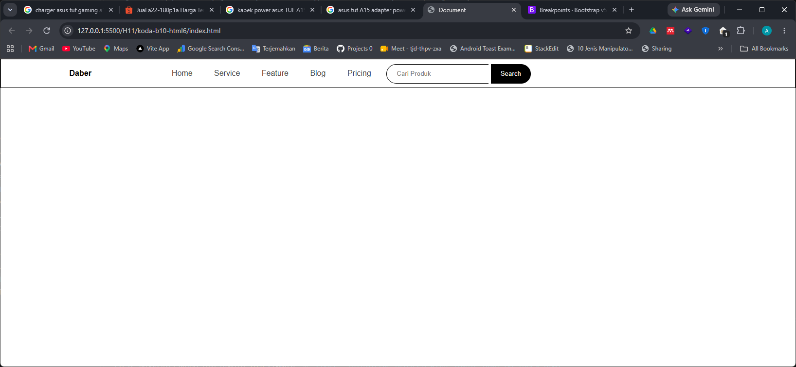
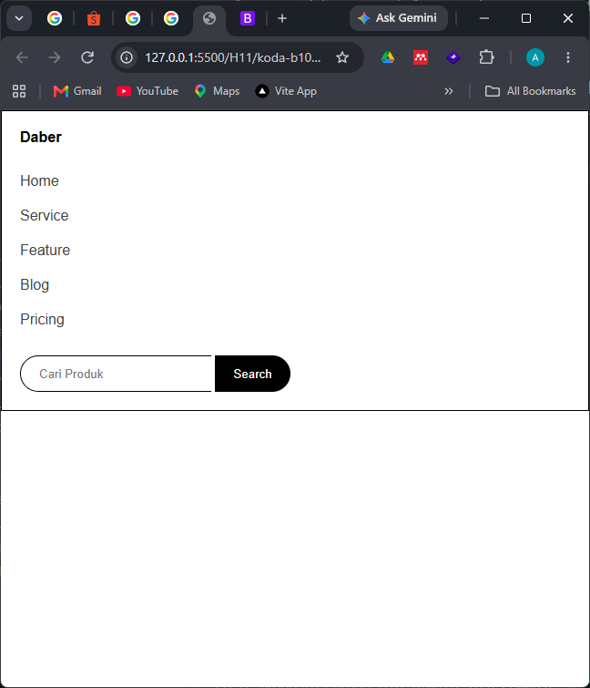

# CSS Media Query
on this repo i learn about css media query, to make a simpel navbar
to become responsive under medium width device

## Result: 
### on larger or medium device width

### on below medium device width
 